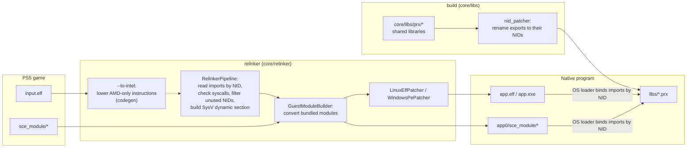
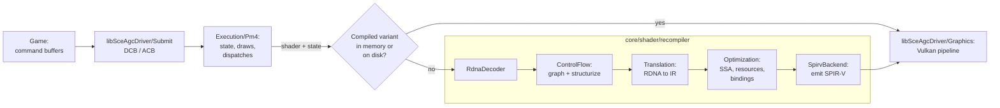

# Architecture

How a PS5 executable becomes a native Linux or Windows program. Nothing is emulated: the converted executable runs as a normal process and calls native implementations of the system libraries.

## Overview

- [`core/relinker/main.cpp`](../../core/relinker/main.cpp) runs the steps in this order. `--to-intel` is optional, see [USAGE.md](../user/USAGE.md).
- Each library in [`core/libs/prx`](../../core/libs/prx) builds as a shared library. After the build, `nid_patcher` ([`core/libs/nid`](../../core/libs/nid)) renames every export to its NID, computed from the function name. `APS5_EXPORT("<nid>", func)` sets the NID directly when the name is unknown.

## Thread cancellation

[`Thread.cpp`](../../core/libs/prx/libkernel/Pthread/src/Thread.cpp) records cancellation requests on the target guest thread. New threads start with cancellation enabled and deferred. A disabled request stays pending; enabling deferred cancellation returns before the next cancellation point acts on it. Repeated requests do not add cleanup invocations.

[`Cancel.hpp`](../../core/libs/prx/libkernel/Pthread/include/Cancel.hpp) connects condition, semaphore and join waits to the request. A canceled condition waiter reacquires its guest mutex before cleanup. Semaphore and join waits release their internal locks before exiting. A request pending on entry to a semaphore wait is acted on before consuming an available token; a canceled join leaves its target joinable and its result output untouched.

Cancellation exits through `scePthreadExit` with result pointer `1`. It runs cleanup handlers in reverse push order before thread-specific destructors; cancellation points inside cleanup must not start another exit. The host thread then terminates through the existing Windows or Linux lifecycle, and join waits for that termination. Host thread termination is not used to inject cancellation into a running guest frame.

The reference contract and constants come from FreeBSD libthr, pinned at [`5ed7eb0d`](https://github.com/freebsd/freebsd-src/blob/5ed7eb0d97ba4436218e810f61bd059acba984c2/lib/libthr/thread/thr_cancel.c), with cleanup and exit ordering in [`thr_exit.c`](https://github.com/freebsd/freebsd-src/blob/5ed7eb0d97ba4436218e810f61bd059acba984c2/lib/libthr/thread/thr_exit.c#L196-L259). These are reference semantics, not console measurements. The supported cancellation points and incomplete asynchronous behavior are listed in [TechnicalDebt](TechnicalDebt.md).

[`GuestPthreadCancelRecovery.cpp`](../../core/libs/tests/GuestPthreadCancelRecovery.cpp) checks pending requests before ordinary and timed semaphore acquisition, cleanup reentrancy and destructor ordering, enabled and disabled timed condition waits, canceled join output, and subsequent resource and thread reuse. Host atomic gates establish pending requests; acquiring the condition mutex after the worker releases it establishes wait entry without a scheduling sleep. Both `guest_pthread_cancel_recovery` and `guest_pthread_cancel_recovery_coarse` retain checks in Release and have a 20-second timeout, shorter than the 60-second guest waits. The latter sets `APS5_COARSE_TIMED_WAITS=1` to exercise the Windows fallback; Linux uses that condition-variable path by default.

## APR and AMM command buffers

[`Apr.cpp`](../../core/libs/prx/libkernel/Apr/src/Apr.cpp) executes APR and AMM command buffers. A buffer runs on the submitting thread until a `WaitOnAddress` or `WaitOnCounter` that is not yet satisfied; the rest of it, and every buffer submitted after it, is copied and runs on a worker thread, so a submitter that satisfies the wait after the submit returns does not hang. Buffers without such a wait still complete before the submit returns.

APR and AMM each have their own queue and worker thread. Order is kept inside a queue; a wait in one does not hold up the other, because AMM `WriteAddress` commands advance the counters that APR buffers wait on. Submission ids are per queue, and `sceKernelAprWaitCommandBuffer` and `sceAmprAmmWaitCommandBufferCompletion` block until the queue has completed that id. A command that throws on a worker aborts the process.

[`GuestAmpr.cpp`](../../core/libs/tests/GuestAmpr.cpp) checks both cases: a submit whose wait is satisfied afterwards returns and keeps buffer order, and an AMM buffer submitted after a waiting APR buffer still completes.

## Graphics

- [`Recompiler.cpp`](../../core/shader/recompiler/Recompiler.cpp) runs the stages in this order. With `ANYPS5_ENABLE_SPIRV_TOOLS`, the SPIR-V is also validated and optimized with SPIRV-Tools.
- `SpirvTarget::subgroupStages` carries the device's `subgroupSupportedStages`. For a vertex, local or tessellation-evaluation program on a target without subgroups in that stage (MoltenVK), [`LaneLocalLowering`](../../core/shader/recompiler/Optimization/src/LaneLocalLowering.cpp) runs after the static interface is applied: it folds lane-index values that are the same for every lane of the wave, rewrites own-lane bit tests of ballot words to the predicate itself, replaces first-lane reads of wave-uniform values, runs waterfall loops once with the lane's own value of the `v_readfirstlane` operand when every effect and carried value is masked by the lane's match and an exhaustive walk of the loop's boolean mask state shows that each lane matches exactly once before the exit, and marks `execz`/`vccz` branches lane-local when their regions are proven EXEC-masked and their merge phis unchanged for skipping lanes. What remains is reported with its guest addresses, and the SPIR-V emitter refuses any leftover subgroup use for such a stage. `APS5_SUBGROUP_STAGES=<hex>` removes stages from the device's mask to test this on any GPU.
- `ShaderRecompiler::Recompile` keeps compiled variants in memory, and `ShaderDiskCache` stores them on disk so later runs reuse them.
- A compute shader whose LDS plus its lock dword exceeds the host's `maxComputeSharedMemorySize` is not given a `Workgroup` array. `Recompile` sets `ShaderInfo::sharedMemoryBytes` for it and the SPIR-V backend addresses the LDS in a coherent storage buffer at descriptor set 1 (`WorkgroupMemoryDescriptorSet`), with a slice of `RecompileResult::workgroupMemoryDwords` per workgroup, indexed by `WorkgroupID` and `NumWorkGroups`. `VulkanDevice` keeps one such buffer, sized from the dispatch dimensions, and binds it after the resource set; programs that fit keep using shared memory.
- `Driver::RegisterShader` splits shader preparation in two. `PlanRegistered` runs on the registering guest thread: it validates the registers and entry point, decodes the code and builds the recompile request, so invalid registrations still fail there. The RDNA to IR translation and resource plan (`PrepareShader`) run on a background pool of `hardware_concurrency() / 2` detached threads (at least 2, 64 MiB stacks).
- The shader registry maps a code address to every header registered for that code, in registration order. Static, graphics and rectangle ABI resolution pick the header at the bound address (or one equal to it, `SameHeader`, which also takes a hull header fused by `sceAgcFuseShaderHalves` (type 3) as the registered back half (type 7) it copies, the fused registers aside; graphics ABI resolution then uses the fused header's shader registers); draws and dispatches pick the program by the stage's binary type (`RegisteredProgram`), and a front entry matching both type 2 and type 4 throws. Within a type the last registration wins; re-registering an identical earlier header makes its snapshot current again without preparing it again, and changed code drops the older headers.
- The snapshot is published as pending. `SourceHandleFor`, `InvocationFor` and `ShaderPreparationTransaction::Edit` / `Read` wait for the pending job before reading `PreparedShaders`, and rethrow its failure. `APS5_SYNC_SHADER_PREPARE=1` prepares on the registering thread instead.
- A draw or dispatch whose state matches no artifact prepared at registration (a title that builds its static ABI state itself, without `sceAgcDriverResolve*Abi`) gets one prepared at use by `SourceHandleFor` or `InvocationFor`, logged once per artifact and kept in the snapshot for the next use.
- A compute shader whose `s_swappc_b64` calls a user-data pointer cannot be linked at registration, because the callee's address is only known at dispatch. `InvocationFor` in [`ShaderRegistry.cpp`](../../core/libs/prx/libSceAgcDriver/Execution/src/Driver/Shaders/ShaderRegistry.cpp) reads each callee from guest memory, appends one copy per call after the caller (`LinkUserDataCalls`) and prepares that linked code, so a different callee gets its own prepared entry.
- A draw's `Graphics::Pipeline` comes from `CachedPipeline`. When the device has `VK_EXT_graphics_pipeline_library` with fast linking, `VK_EXT_extended_dynamic_state` and `VK_KHR_dynamic_rendering`, draws render with `vkCmdBeginRenderingKHR` instead of render passes and the pipeline is linked from four libraries (vertex input, pre-rasterization shaders, fragment shader, fragment output) kept per device in [`PipelineLibrary.cpp`](../../core/libs/prx/libSceAgcDriver/Graphics/src/PipelineLibrary.cpp). A library built for one pipeline is reused by the next: another blend, vertex layout or target format builds only that part (the shader libraries name no attachment format), and cull mode, front face, depth and stencil state are dynamic, so changing them only links. The fast link is what the draw waits for; a background thread then links the same libraries with link-time optimization and the pipeline binds that one from the next draw on. Push constants then use a 256-byte block with a 128-byte slot per side: the pre-rasterization stages stack from byte 0, the pixel shader always starts at byte 128 (`StagePushOffset`), so its library does not depend on how much push data its vertex shader uses. Pipelines with per-face depth bias, a separate alpha blend into an 8_8 target with the alternate component order (both draw twice), rect lists, geometry shaders or a stage without a variant id are created whole, still with dynamic rendering; devices without the extensions (or with `APS5_NO_GPL=1`) keep render passes and whole pipelines.
- A draw whose `PA_SC_AA_CONFIG` selects 2, 4 or 8 samples renders into host-only multisampled images. [`MultisampleTarget.cpp`](../../core/libs/prx/libSceAgcDriver/Graphics/src/MultisampleTarget.cpp) keeps one image per device, surface address, format, extent and sample count (`MultisampleTargetView`); the pipeline, render pass and library keys carry `State::samples`, and a multisampled depth target is a multisampled depth surface. The guest sample planes and FMASK are never read or written, so the registry also guards the target's guest range: a CPU read (`GuestMemory::SetReadGuard`), a DMA copy, and a sampled or storage image read of it throw. A `CB_COLOR_CONTROL` resolve mode over a multisampled CB0 runs as a render pass whose resolve attachment is CB1's resident image (`ResolveMultisampleTarget`). A zero fill of the target's CMASK (`NoteColorMetadataFill`, from fill kernels and CP DMA fills) clears the image at its next use.
- A sampled texture that has no storage view (block-compressed formats, or memory outside host imports) is cached as a snapshot of its guest bytes in [`ShaderResources.cpp`](../../core/libs/prx/libSceAgcDriver/Graphics/src/ShaderResources.cpp), and each lookup proves the snapshot current. In write-watched memory, `GuestMemory::UnchangedSince` is the proof. Host imports under the macOS write watch, which compares page contents instead of protecting pages, are compared, not watched: a GPU write into an import would be reported as a CPU store. For those, the snapshot is compared with guest memory, and a successful comparison is remembered with the present count (`Recorder::Presents()`), the time, `GuestMemory::ForgetSerial()` and the serial of the driver write log (`GuestMemory::NoteDriverWrite`, fed by every driver store, `MarkWritten` and recorded GPU write). A later lookup reuses the proof while no frame was presented, the proof is younger than `APS5_SNAPSHOT_PROOF_MS` (500 ms by default), no forget happened and `GuestMemory::DriverWroteOver` finds no logged write over the surface since; a write log that wrapped past the proof counts as written. The driver's own waits and syncs do not end a proof, so a surface is compared at most once per presented frame or lifetime, plus once after each driver write over it. This is an approximation: a guest CPU store into host-imported texture memory is seen at the next present or when the proof expires, whichever comes first, not at the next wait. Every 10 seconds a `[resources] snapshot proofs` line reports memo hits and compares, with the reason for each compare. `APS5_NO_SNAPSHOT_PROOF_MEMO=1` compares at every lookup, the exact path.
- A block-compressed surface in host-imported memory whose DCC keys read uncompressed keeps no CPU snapshot and is never compared on the CPU: `Texture`'s host-import constructor and `Texture::RefreshFromImport` detile it on the GPU straight from the imported `VkBuffer` at the surface's offset into a pooled linear buffer and copy that into the BC image. The lookup refreshes it when the proof above does not hold (a present since, an expired proof, a forget, or a logged driver write over the surface), so the GPU rereads guest memory at most once per presented frame and the CPU's stores are seen with the same latency as the compared snapshots. Comparing a frame's worth of large surfaces was the frame time when the host was short of memory (a title mapping about 6 GiB of direct memory on a 24 GB Mac): the compares ran at about 1.5 GB/s against about 24 GB/s for the same compare in a test, and the CPU snapshot was a second copy of every such texture. `APS5_NO_IMPORTED_SNAPSHOT_REFRESH=1` keeps those surfaces compared snapshots; `APS5_NO_SNAPSHOT_PROOF_MEMO=1` disables both and compares at every lookup. The `[resources] snapshot proofs` line also counts the GPU refreshes and, since its previous line, the bytes compared, the compare rate and the process's minor and major page faults.
- A refresh of such a surface is gated by a GPU hash of the imported range (`Graphics/shaders/SurfaceHash.comp`, recorded by `Recorder::RecordSurfaceHash`): a reduction over the surface's 16-byte blocks through its buffer device address into a 128-bit digest of position-mixed 32-bit words summed and XORed in two lanes each, read once from a host-visible buffer. When the proof above lapses at a present the lookup records a hash pass instead of a refresh; a later lookup that finds the pass's batch finished compares the digest with the stored one and refreshes only when it differs, recording a new hash just before the detile so the stored digest describes the bytes the image holds. A logged driver write over the surface refreshes at once. An unchanged surface therefore costs one read of its bytes per presented frame, and a CPU store is seen at the first lookup after the hash that follows it completes. In the recorder test a hash pass over 16 MiB took about 0.23 ms of GPU time against about 0.77 ms for the detile and copy it saves; a compare of a kept tiled copy driving indirect dispatches would read twice the bytes, hold a second GPU copy of every surface and still need an unconditional copy into the BC image. Once a change was seen (a digest that differs from the stored one), the surface is refreshed at the first lookup after every present for the next `APS5_IMPORTED_REFRESH_RECENT_PRESENTS` presents (120 by default), so a title that streams animation frames into an atlas samples the new frame from the first draw after the present; only a surface that stayed unchanged that long goes back to the hash gate, where the first change is seen one lookup late. The gate then backs off. A surface whose digest has not changed for 60 presents is hashed every 2nd present, after 120 presents every 4th, and after 180 presents every 8th (`APS5_IMPORTED_HASH_MAX_INTERVAL`, 8 by default; 1 hashes at every present). So a change to an atlas left alone that long is seen up to that many presents late, and any change resets the back-off. In Hades II the gate hashed about 1 GB of atlases per present, a large share of the GPU time. Only sampled surfaces are looked up, so only they are hashed. A lookup that refreshed the surface because its digest changed records its proof and does not refresh again in the same lookup. Before, a driver write over the surface while a hash was in flight left the digest unknown, and the surface was then refreshed twice at every present. Refreshing every such surface at the first lookup after every present instead (the default for a short while) re-detiled every atlas once per frame, about 7 GB/s of GPU traffic in Hades II, and cut its frame rate by half. A digest collision would keep a changed surface stale until its next change; `APS5_NO_IMPORTED_SNAPSHOT_HASH=1` refreshes at every lapsed proof instead. The `[resources] snapshot proofs` line counts the hash passes and the unchanged results. A `[resources] snapshot lookup CPU time` line before it gives, since its previous line, the calls and CPU time of every sampled lookup and of the imported path's phases (imported hits, import find, proof, hash record, digest read, refresh record); under `APS5_PROFILE_GPU=1` the hash passes and refreshes are timed on the GPU as the `surface-hash` and `snapshot-refresh` classes of the `[gputime]` line.
- While GPU copies of such an image are in flight, `original` stays valid outside the units they cover (`StorageTexture::inFlightOverlaps`): a compare treats those units as unchanged unless a driver store reached them since the copy, and compares the rest, so a write-back no longer makes the whole surface look changed and re-uploaded. An image whose compare once found a CPU store (`cpuWriter`) is treated exactly: a remembered match or an in-flight answer holds only within the collect epoch it was taken in, and at a new epoch the refresh first completes the recorder's finished batches (`Recorder::Reap`) so their copies land before it compares. It does not wait for the rest: a copy still running is the tail of a write-back the title has not waited for, so no CPU store can be ordered after it, and the units it covers keep the in-flight answer. Waiting for the GPU there (`Recorder::Sync`) was about half of the time Hades II spent refreshing resident targets in gameplay.
- A stored copy that is not valid must become valid again through some copy. A whole-surface upload from an import now marks `original` valid as soon as its copy is recorded, because the units that copy covers are answered as unchanged until it lands. A block write-back that cannot record a copy of its own ranges (no valid `original` and no whole-surface copy in flight, or slab pieces in the write-back) now copies the whole surface from the import behind its stores instead. In Hades II the 1920x1080 target started with `original` invalid and never recovered: each write-back took no copy because `original` was invalid, and each refresh then re-uploaded and wrote back all 135 units, about once per present. Every invalidation of `original` names its cause, and under `APS5_TRACE_UPLOAD=1` it is printed with each upload and with each write-back that took no range copy.
- `original` describes guest memory, not the image. A fill the driver turns into a clear of a resident target (`StorageTexture::FillClear`), and a copy it turns into an image copy (`CopyFrom`), change the image and leave guest memory as it was until the write-back. They mark the units pending and keep `original` valid. Their `MarkWritten` goes into the driver write log as a deferred write, like a recorded GPU write, so a compare keeps answering the units an in-flight copy covers. A fill that supersedes pending results (`DiscardPendingInside`) leaves `original` valid too, but marks the dropped units as image-stale. Those units are re-uploaded at the next refresh even if the guest bytes still equal `original` (the fill may have written the same bytes the copy holds), and a clear or an upload of a unit clears its mark. Only a guest or driver store that the compare sees, or the driver's own write-back, changes `original`. Hades II clears its 1920x1080 target with a fill every frame. Each clear and each discard used to invalidate `original`, so every refresh wrote back and re-uploaded the whole surface. `StorageTexture::Uploads()` counts uploads for the tests. Some uniform buffer fills cannot be turned into a clear, for example when the fill covers more than the image or the clear was refused. Those are stored on the GPU, and every image wholly inside such a fill without pending results is now cleared to the same value on the GPU as well (`StorageTexture::ClearFilledInside`). Its `original` is set to the fill's bytes and its remembered match is renewed, so the next refresh does not re-upload the surface the fill just wrote. In Hades II these re-uploads were most of the 178 remaining uploads per 10 s. `APS5_NO_FILLED_IMAGE_CLEAR=1` re-uploads as before. The clear also records a copy in flight that carries no bytes. It only masks the surface until the fill's batch completes. A compare of an image with copies in flight now waits only for the GPU writes over the units no copy covers (`GuestMemory::FlushGpuWrites` per run of uncovered 64 KiB blocks), not for every write over the surface. In Hades II that wait (a `Recorder::Sync` behind the title's fills and the image's own write-backs) was 66 of the 119 samples of `refreshResidentTarget`, about 29 ms per slow target lookup. Units marked image-stale are treated the same way: they are uploaded at the refresh anyway, in GPU order behind the write that made them stale. So a compare neither waits for the GPU writes over them nor reads their bytes; bytes read halfway through a GPU fill would also mark the target as written by the CPU. Each image wholly inside a GPU fill that cannot be a clear (a pattern that is not one texel, or a format that cannot hold it) is marked image-stale for the same reason. In Hades II, 155 GPU waits per 10 s behind such fills cost about 7 s. Uploads forced by discarded units are counted under the "discarded" reason.
- The presenter reads the DCC keys of the display buffer it shows (`DisplayBufferKeys`). When GPU writes of those keys are still pending, it used to wait for them while holding the GPU mutex, which stalled the queue threads' draws behind the present: about 1 s per 10 s in Hades II gameplay, and 6 s with an occluded window. On the presenter thread the wait now uses `Recorder::SyncThrough` with `waitUnlocked`, as the flush hook does: the GPU wait runs without the mutex, which is retaken for the completions. `APS5_PRESENT_KEYS_LOCKED=1` waits under the mutex as before. Before any wait, the keys under pending GPU writes are worked out from the writes themselves when every pending write over them is a uniform byte fill (the title's key fills and the driver's own 0xff stores): the newest fill wins for each key range, and keys no pending write covers are read from memory (`PendingWrittenKeys` in `DccMetadata.cpp`). A pending write of unknown bytes, such as a kernel's store or a patterned fill, still waits. In the owner's Hades II run the presenter waited about 55 ms per present for those writes (about 4 s per 10 s), and its blit went out 50-100 ms after the flip packet, which showed as a dropped frame followed by a catch-up. The `[dcc]` line counts the keys answered and waited for. `APS5_NO_PENDING_KEY_VALUES=1` waits as before.
- A draw captures each of its shader stages: the resource walk evaluates the stage's SRT program over the user data and guest memory (`ShaderMemory::Capture`), about 3 us per capture in Hades II, about two captures per draw. The draw thread now remembers a walk per prepared shader, shader base and user data words, together with every dword it read and every accessibility probe it made, in call order. A later capture with the same key replays those reads and probes through the new `ShaderMemory`, which records the same regions and runs the same pending-write handling. When every answer matches, it reuses the remembered capture instead of walking again, so the memo is exact: any changed word walks again. `APS5_NO_CAPTURE_MEMO=1` walks every time. The `[capture]` line counts the memo hits, the walks, and the walks made because a word changed.
- A retired host import is kept until a batch opened after its retirement completes, because a cached descriptor set proven before the retirement may still be recorded into the next batch. The retired import holds the registry ranges it imported, so while it waits the guest range stays pinned. When the guest unmaps or reprotects that range, the pin waiter (`WaitForLeasesAndImports`) finishes the recorder's work and then frees the retired imports over the range at once if nothing is in flight: no later batch may read memory the guest released. Before that, a release with an idle recorder waited out `APS5_PIN_WAIT_MS` and threw (the alpha-to-coverage test's teardown).
- A storage image whose memory is compared, not watched (a resident target in a host import under the macOS watch), compared its whole surface with `original` at every refresh, once per draw that used it. `StorageTexture::compareUntracked` now remembers a whole-surface match with the present count, the time, the forget serial and the driver write log serial, and reuses it while no frame was presented, the match is younger than 500 ms, no forget happened and no driver store or `MarkWritten` touched the surface since (`GuestMemory::DriverWroteOver` with stores only: the recorded GPU writes of draws into the target leave guest memory alone until a write-back, which marks it written). Every change of `original` drops the match. This is an approximation: a guest CPU store into such a surface is seen at the next present or within 500 ms. A remembered match answers before the GPU writes pending over the surface are waited for; a compare still waits for them first. A thread that never reached an ordering point (collect epoch 0, such as a test thread that fills a target between draws) keeps no match and takes no answer from a copy in flight, so it compares every time. `APS5_NO_SNAPSHOT_PROOF_MEMO=1` compares every time. The driver write log keeps recorded GPU writes apart from driver stores for this. The `[storage]` line counts the untracked compares and the ones a match answered.
- On macOS the driver's guest-memory accessibility checks (`GuestMemory::Accessible`, `CheckRange`, `CompareMapped` and the shader memory reads that use them) asked the kernel with `mach_vm_region` at every call, about 13% of the driver thread's samples in gameplay. Each thread now keeps the last 16 readable regions it was told about, clipped to the registered guest allocation that contains them, stamped with the allocation registry's generation, and answers from them while the generation holds. Every registry mutation (map, unmap, protect) advances the generation after it changes the host protection, and the guest stack protection paths that bypass the registry (`DoMprotect` on a guest stack, `RestoreStackPages` at thread exit) advance it too, so the answers are exact. Unreadable runs and memory outside the registry are not cached. `APS5_NO_REGION_CACHE=1` queries every time; the `[guestmem]` profile line counts queries and cached answers.
- The draw cache (captured shader resources per draw key, `Driver::lookupDraw` and `Driver::insertDrawEntry`) is skipped while it does not pay: each queue counts hits over windows of 4096 lookups, and a window with fewer than 41 hits skips draw entries for the next 16384 draws of that queue before measuring again, doubling the pause for every further window without hits up to 64 times as long (reported once per pause on stderr). A title whose draws rarely repeat their resources otherwise inserted and evicted an entry at every draw. `APS5_NO_DRAW_CACHE_GOVERNOR=1` always uses the entries. The `[gputime]` line counts draws and dispatches and their averages per present. A pipeline cache miss builds its pipeline on the draw thread. The `[pipecache]` line gives the time those builds took and the longest one, and under `APS5_PROFILE_DRAW=1` or `APS5_TRACE_PIPELINE_MISSES=1` each miss prints its build time and the stages and guest addresses of its programs. MoltenVK on this Mac exposes neither `VK_KHR_pipeline_binary` nor graphics pipeline libraries, so a Metal binary archive cannot be filled through Vulkan. Metal's own per-application compiler cache already keeps compiled MSL across runs: in the tests a repeated build takes 0.2-0.6 ms against 8 ms for the first.
- A draw into the same resident color target as the previous draw on its thread, in the same collect epoch and present, with no forget, no driver store or recorded GPU write (a fill, a copy, a write-back) over the target since and no other image's results pending over it, takes the image the previous draw looked up without another storage-cache lookup and refresh (`repeatedResidentTarget` in `Draw.cpp`); the register and CMASK clears still run. Within an epoch the refresh would have answered from its remembered match anyway. `APS5_NO_RESIDENT_TARGET_REPEAT=1` looks the target up at every draw. Under `APS5_PROFILE_DRAW=1` a `[draw-batch]` line next to the `[draws]` line measures how far draws could be merged into indirect multi-draws, before any merging is built. It counts the recorded draws that form runs of two or more, where each run continues one render pass with the same pipeline and the same descriptor set and is not indirect, mesh, instanced or split. It gives the run lengths, how many joined draws changed their push constants (these would need a per-draw constant buffer), and what ended each run: an ineligible draw, a new render pass, another pipeline, or other descriptors (which would need bindless descriptors). Every draw that snapshots a guest buffer writes a descriptor set of its own, so the set handle always differs. A second `[draw-batch]` line therefore classifies each descriptor break by its costliest difference from the previous draw's resources (`ShaderResources::CompareDescriptors`): another layout, other images, other samplers only, buffers of other sizes, buffers at other addresses or with other data, only per-draw buffer snapshots, or the same contents. It also gives the average number of differing image and buffer bindings per break. Differences in buffers only could be covered by a per-draw constant ring with dynamic offsets or buffer device addresses; different images need bindless image descriptors.
- The buffer pool (`Graphics/src/BufferPool.cpp`) retains allocations by capacity class, and a taken allocation whose `VkBuffer` has another size gets a new `VkBuffer` bound at the requested size (buffers keep their exact size). `Take` now prefers, among the last 16 retained allocations of the class, one whose `VkBuffer` already has the requested size, so draws that ask for the same sizes again stop destroying and binding buffers; the `[bufferpool]` profile line counts such hits.
- `vkQueueSubmit` of recorded batches runs on a submit thread per queue (`QueueSubmitter` in [`Recorder.cpp`](../../core/libs/prx/libSceAgcDriver/Graphics/src/Recorder.cpp)): under MoltenVK a submit encodes the whole command buffer into Metal, about a tenth of the driver thread in gameplay. `Recorder::Submit` ends the batch, assigns its serial and hands it to the thread in order; from then on it counts as submitted (`Submissions`, in-flight list, label deadlines), and waits on its fence or timeline value simply wait until the thread has submitted it. Every other use of the queue (`CommandBatch` submits and idle waits, the presentation clear and present, the import probe, `VulkanDevice::WaitIdle`) first drains the thread and then holds its queue mutex (`QueueSubmitter::Access`), so work handed over earlier reaches the queue first and the queue is never used by two threads at once. A failed submit is rethrown at the next hand-off or drain. `APS5_NO_SUBMIT_THREAD=1` submits on the recording thread.
- A draw's resource capture (`ShaderMemory`) reads the guest words its resource tables need. A page the driver has no recorded GPU write over is no longer copied whole on first touch: it is checked accessible and passed through the flush hook once (so deferred results of storage images and shadowed units reach it, as a page copy did) and each word is read from guest memory when the capture first asks for it (`APS5_NO_DIRECT_CAPTURE_WORDS=1` copies whole pages as before). `PreparedShaderInvocation::TryCreate` validates a prepared shader's stage input info once per prepared source handle and thread instead of at every draw, since the prepared key it matches fixes that input (`APS5_VALIDATE_INPUT_INFO_EACH_USE=1` validates at every use).
- A storage image uploaded straight from a host import whose memory is compared, not watched, keeps `original` (the guest bytes the image matches) without reading guest memory on the CPU: `StorageTexture::recordBaseline` copies the surface from the import into a host-visible buffer on the GPU, recorded before the detile, and `landBaseline` moves it into `original` at the first refresh after that batch finished (`Recorder::BatchFinished`). Reading the bytes on the CPU waited for every recorded GPU write over the surface first, the image's own write-back included, a full submit and fence wait per refresh. While the copy is in flight a refresh answers that the image is current unless it flushed other images' results into the surface, a driver store or `MarkWritten` landed there since (`GuestMemory::DriverWroteOver` with stores only; recorded GPU writes are logged apart), or the DCC keys changed; a guest CPU store in that window is seen at the first refresh after the copy lands. `APS5_NO_GPU_BASELINE=1` reads the bytes on the CPU as before. A GPU-direct write-back of block units that stores whole units records such a copy of exactly the bytes it stored, taken from the retile scratch it copied into the import rather than from guest memory, so `original` stays valid and the image is not uploaded again after its own write-back, and a guest CPU store into the surface is never taken into `original`. Copies in flight land in order; one for the whole surface carries the earlier ones' store checks, and a write-back's copy carries them while nothing else stored over the surface. A guest CPU store made before an upload's copy runs is in both the image and `original`. A remembered match with guest memory (below) survives the image's own write-back when nothing else stored over the surface since it was taken: the write-back's own stores are absorbed and the copy behind it lands without dropping the match. The `[storage]` line counts the baselines and the refreshes answered while one was in flight.

### Shader MODE register access

`GuestContext::floatMode` carries the initial shader mode through `Recompile` and `TranslateOptions` into each block's `TranslationContext`. `s_getreg_b32` reads confined to MODE bits 0–3 return the selected initial rounding bits in the destination's low bits. Bits 0–1 select f32 rounding; bits 2–3 select f16/f64 rounding. Missing mode metadata retains the legacy round-to-nearest-even assumption. Reading other MODE fields or hardware registers throws.

An immediate MODE write confined to the rounding fields is accepted only when its selected replacement bits equal the initial state. Source bits above the selected width are ignored. `s_round_mode` similarly compares its low four immediate bits with the initial rounding fields. A state-changing write or an SGPR-sourced MODE write throws with its instruction and program counter. Runtime transitions require control-flow-aware mode tracking and matching arithmetic lowering. Writes to other hardware registers retain their existing behavior and remain technical debt.

The register layout and instruction contract follow [AMD RDNA2 ISA sections 5.8 and 6.4, Table 24](https://www.amd.com/content/dam/amd/en/documents/radeon-tech-docs/instruction-set-architectures/rdna2-shader-instruction-set-architecture.pdf), cross-checked against LLVM 20.1.8's [hardware-register encoding](https://github.com/llvm/llvm-project/blob/87f0227cb60147a26a1eeb4fb06e3b505e9c7261/llvm/lib/Target/AMDGPU/Utils/AMDGPUBaseInfo.h) and [MODE state analysis](https://github.com/llvm/llvm-project/blob/87f0227cb60147a26a1eeb4fb06e3b505e9c7261/llvm/lib/Target/AMDGPU/SIModeRegister.cpp). This contract does not establish arithmetic support for every initial mode or console-specific behavior.

`agc_shader_mode_register` decodes instruction words, builds the control-flow graph and checks production translation without a Vulkan device. It covers rounding subfield reads, masked constant writes, branches, unsupported runtime changes and diagnostics, plus mode propagation through full recompilation. The requirements remain active in Release; CTest bounds execution to 20 seconds.
